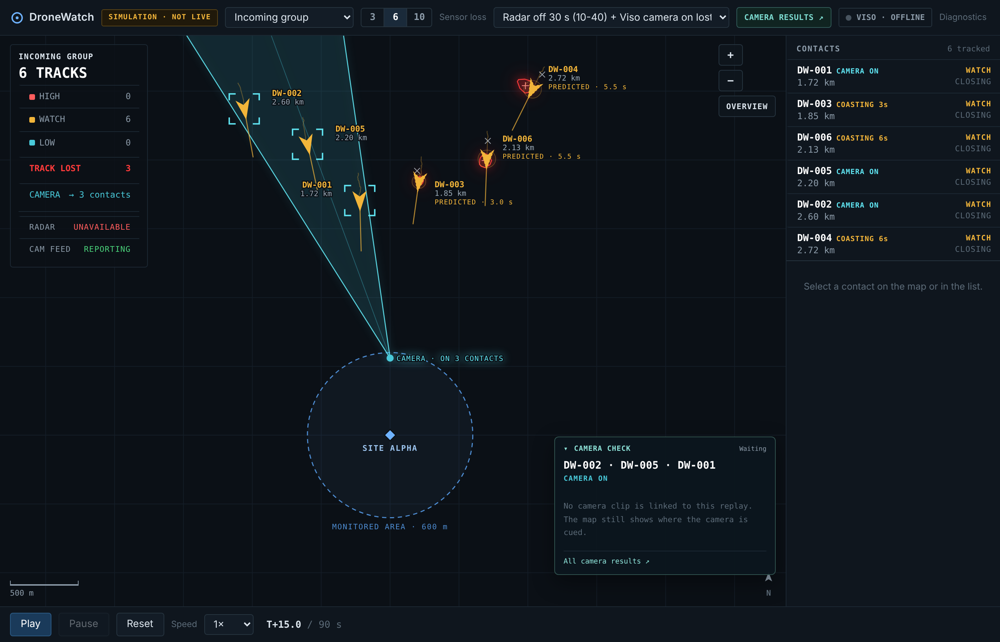

# DroneWatch

DroneWatch is a prototype counter-drone (counter-UAS) tracking and
incident-awareness system in Python. A FastAPI server runs a Kalman-filter
tracker over synthetic multi-sensor reports, replays the result in a browser
operator view, and estimates where a contact could be once its sensor stops
reporting. It also has webhook receivers intended for Viso Now visual-analysis
results; the vendor contract and an end-to-end connection remain unverified.

Everything the tracker sees is synthetic, generated from fixed seeds by
`dronewatch/synthetic/`. No real radar or RF hardware is connected, there is no
live camera stream, and no model is trained. Viso Now results are stored and
shown as evidence; they do not feed positions to the tracker.

> Maturity: prototype. It is not a calibrated radar, a certified counter-UAS
> system, or proof of live airspace coverage. Sensor characteristics are
> invented simulation abstractions, not the performance of any real product.

**Key results**, committed in
[`docs/results/sensor_loss_quick.md`](docs/results/sensor_loss_quick.md):

- Filter consistency over 400 independent runs of the filter's own model: mean
  NEES (4 degrees of freedom) is 4.18, 3.95 and 3.98 at three check points, all
  inside the 95% band [3.72, 4.28]. The 95% position ellipse contains the true
  position in 0.97 of runs during normal tracking and 0.95 at the end of a
  10 s prediction-only gap.
- Full pipeline, six contacts, radar off for 15 s, four held-out seeds:
  position RMSE rises from 8.22 m before the outage to 59.67 m during it, the
  95% ellipse still contains the true position in 0.99 of track-frames, there
  are no identity switches, and all six contacts have a fresh position again
  1.0 s after the radar returns (mean over the four seeds).
- Failures are reported rather than tuned away: a crossing pair averages one
  identity switch per run, and a 30 s outage outlasts the 25 s track retention,
  so all six contacts come back as new identities.



*The operator view (`/preview?demo=viso`) captured from a local run: seed 42, six
synthetic contacts, radar off from 40 to 70 s, simulated camera (labelled
VISO-EO) cued by the tracker. All data is synthetic, and no Viso Now results had
been received.*

## System architecture



*Purple: model call · blue: deterministic code · green: human · amber: evaluation · grey: storage · dashed: external, optional, mocked or planned*

The operator picks a scenario, contact count and sensor-loss mode.
`GET /api/preview/tracks` then generates seeded synthetic observations and
sensor heartbeats with those faults, runs the tracker over them once in
delivery order, and returns 5 Hz frames (estimates, covariances, containment
regions, rule-based priority levels) that the browser replays. In the cued
camera mode the tracker runs twice: a radar-only pass decides where the
simulated camera points, and a second pass adds its synthetic detections. Viso
Now results enter only through the webhooks, are stored in SQLite and shown as
non-spatial evidence, and never update a track. Ground truth never reaches the
server or the browser; only `experiments/sensor_loss.py`, the tests and the
offline dataset export (`python -m dronewatch.synthetic.generate`) read it.

## Does it use AI at runtime?

No. This repository contains no machine-learning model, LLM or trained
component: tracking, containment, priority levels and camera cueing are
deterministic or seeded Monte Carlo code. Visual analysis, when used, happens
in the external Viso Now service, whose results are kept as evidence only.

## Run it online (nothing to install)

- **Live demo, nothing to start:** <https://retinapeg.github.io/dronewatch/> — the operator view replaying the
  tracker's recorded output for every scenario, contact count and sensor-loss mode (seed 42), including the
  Monte Carlo containment cloud for each lost contact. Static, so it never sleeps; camera clips and Viso Now
  results need the server (see [`site/README.md`](site/README.md)).
- **Render (free tier):** Render -> *New* -> *Blueprint* -> pick this repo. `render.yaml` and the
  `Dockerfile` do the rest. The free tier sleeps after 15 minutes idle; the first load after that
  takes about 30 s. Open `/` once it is up.
- Any Docker host: `docker build -t dronewatch . && docker run -p 8000:8000 dronewatch`.

The hosted instance has no Viso webhook secret set, so it accepts no Viso deliveries. Set `DRONEWATCH_WEBHOOK_SECRET` in the service's
environment to enable the authenticated `/v2/webhook/viso` receiver.

## Quick start

Requires Python 3.11+. Node.js 24+ is needed only for the JavaScript tests. No
API keys are needed for the tracker, the preview or the test suite.

```bash
git clone https://github.com/retinapeg/dronewatch.git
cd dronewatch
python3 -m venv .venv
.venv/bin/python -m pip install --upgrade pip setuptools
.venv/bin/python -m pip install -r requirements.txt
.venv/bin/python -m pytest -q
.venv/bin/uvicorn main:app --host 127.0.0.1 --port 8000
```

Open <http://127.0.0.1:8000/preview>, pick a sensor-loss mode and press Play.
To regenerate the results tables:

```bash
.venv/bin/python -m experiments.sensor_loss                  # writes docs/results/sensor_loss_quick.{md,json}
.venv/bin/python -m experiments.sensor_loss --out /tmp/dw    # write elsewhere instead
```

The runs are seeded, so a rerun reproduces the tables apart from the wall-clock
`ms` column. `--full` runs 20 held-out seeds and 2000 filter-consistency runs.

## Tracking and estimation

The derivations, parameter choices and an equation-to-test map are in
[`docs/SENSOR_LOSS_MATH.md`](docs/SENSOR_LOSS_MATH.md). In summary:

### Kalman filter

[`dronewatch/tracks/kalman.py`](dronewatch/tracks/kalman.py), tested in
[`tests/test_kalman.py`](tests/test_kalman.py).

- State `[p_x, p_y, v_x, v_y]` in a local planar frame. Altitude is carried
  beside the track, not estimated.
- Nearly-constant-velocity motion with continuous white-noise acceleration.
  `F(dt)` and `Q(dt)` are derived from the SDE `dp = v dt, dv = dW`, and
  prediction uses the actual elapsed event time, so a gap predicted in one step
  or in many gives the same distribution. A deliberate negative test shows the
  discrete "random constant acceleration" model does not have this property.
- Joseph-form covariance update, `P = (I - KH) P (I - KH)^T + K R K^T`, with the
  gain obtained by a Cholesky solve rather than a matrix inverse. Measurement
  covariances are validated before use.
- Position (full or single-axis) and bearing-only measurement models. The
  bearing innovation is wrapped to (-pi, pi], and a bearing can refine a track
  but cannot start one.
- The estimation code is pure Python; numpy is not in `requirements.txt`.

### Association and track management

[`dronewatch/tracks/tracker.py`](dronewatch/tracks/tracker.py).

- Chi-squared gating on the innovation: `d^2 = nu^T S^-1 nu <= 25` for 2-dof
  position reports and `<= 13` for 1-dof bearings. The 2-dof gate is
  deliberately loose (beyond the 99.99% point of chi-squared(2)) so that a
  constant-velocity filter lagging a gentle turn does not spawn a phantom.
- Among gated candidates the tracker picks the lowest `d^2 + ln|S|`, so a track
  with a huge covariance does not win every report. A margin below 2 to the
  runner-up is recorded as an ambiguous association. Association is greedy
  nearest-neighbour, not a joint assignment.
- Late reports within 1.5 s are applied by rolling back to a checkpoint and
  replaying, which reproduces the in-order posterior (tested to 1e-9). Older
  reports are rejected and counted; duplicates are dropped by observation ID.
- Lifecycle, freshness and source health are separate states. Source health
  comes from sensor heartbeats, never from the absence of detections.

### Lost contacts: Itô SDE Monte Carlo containment

[`dronewatch/tracks/uncertainty.py`](dronewatch/tracks/uncertainty.py), tested
in [`tests/test_sensor_loss.py`](tests/test_sensor_loss.py), served by
`GET /api/preview/paths`.

- When a contact stops being observed, sample paths of the tracker's own Itô
  SDE forward from a draw of the track's estimated state and covariance,
  stepped with Euler-Maruyama.
- For this model the closed form exists, so the sampler is used as a check and
  as something an operator can read. `test_monte_carlo_agrees_with_the_closed_form`
  requires the sampled 95% radius to be within 4% of the analytic one and the
  empirical containment to lie in [0.93, 0.97] at 5, 20 and 40 s.
- The reported R95 is the major semi-axis of the 95% ellipse (chi-squared(2)
  quantile 5.991): the smallest circle centred on the estimate that contains
  the whole ellipse, so it never understates the search area.
- A behaviour-adaptive variant fits the recent track history for speed,
  heading and turn rate, samples a weighted mixture of coordinated-turn
  regimes with a speed bound, and draws the convex hull of the innermost 95% of
  endpoints. The mixture has no closed form, and its weights are stated in the
  code rather than fitted.
- A handover check reports when a track's containment radius has outgrown an
  illustrative sensor acquisition basket. It is decision support that fails
  closed, not fire control.

### Evaluation: NEES, NIS and pipeline metrics

[`experiments/sensor_loss.py`](experiments/sensor_loss.py) evaluates two layers
separately, because a correct filter can still sit inside a tracker that
associates the wrong measurements.

**Layer A, matched-model consistency.** Truth is generated by the filter's own
model with known association, 400 independent runs, a 10 s blackout from step
40 to step 59, NEES and NIS read at fixed steps.

| statistic | value | 95% band for the mean |
|---|---|---|
| NEES(4) mean, step 20 | 4.177 | [3.72, 4.28] |
| NEES(4) mean, step 39 | 3.947 | [3.72, 4.28] |
| NEES(4) mean, step 79 | 3.984 | [3.72, 4.28] |
| NIS(2) mean, step 20 | 2.066 | [1.8, 2.2] |
| NIS(2) mean, step 39 | 1.851 | [1.8, 2.2] |
| NIS(2) mean, step 79 | 1.911 | [1.8, 2.2] |
| 95% ellipse coverage, normal | 0.97 | nominal 0.95 |
| 95% ellipse coverage, end of 10 s gap | 0.95 | nominal 0.95 |

**Layer B, the full pipeline.** The 3, 6 and 10-contact tracker with
association, delivery effects and injected faults, scored against ground truth
the tracker never sees. Held-out seeds 2024, 31337, 99 and 555; the development
seeds 42, 7 and 1234 are excluded. Values are means per run; "during" is the
fault window; recovery was achieved in all four runs of every experiment.

| experiment | contacts | during: RMSE (m) / 95% coverage | missing | fragments | id switches | impure tracks | recovery (s) |
|---|---|---|---|---|---|---|---|
| `normal` | 6 | 8.62 / 0.99 | 0.0 | 0 | 0 | 0 | 0.2 |
| `radar_off_5s` | 6 | 19.52 / 1.0 | 0.0 | 0 | 0 | 0 | 1.0 |
| `radar_off_15s` | 6 | 59.67 / 0.99 | 0.0 | 0 | 0 | 0 | 1.0 |
| `radar_off_30s` | 6 | 66.8 / 1.0 | 0.1 | 6 | 6 | 0 | 2.1 |
| `single_contact_loss` | 6 | 16.88 / 0.99 | 0.0 | 0 | 0 | 0 | 0.8 |
| `all_positional_off` | 6 | 59.0 / 0.97 | 0.0 | 0 | 0 | 0 | 1.0 |
| `radar_off_backup_eo` | 6 | 25.43 / 0.97 | 0.0 | 0 | 0 | 0 | 0.5 |
| `radar_off_backup_brg` | 6 | 60.3 / 0.95 | 0.0 | 0 | 0 | 0 | 1.0 |
| `radar_off_rf_evidence` | 6 | 59.67 / 0.99 | 0.0 | 0 | 0 | 0 | 1.0 |
| `sparse_radar_0p5hz` | 6 | 14.78 / 0.98 | 0.0 | 0 | 0 | 0 | 0.2 |
| `radar_degraded_x4` | 6 | 21.73 / 0.98 | 0.0 | 0 | 0 | 0 | 0.2 |
| `delayed_duplicates` | 6 | 59.4 / 0.99 | 0.0 | 0 | 0 | 0 | 2.8 |
| `crossing_blackout` | 6 | 29.65 / 1.0 | 0.0 | 0 | 1 | 0 | 1.1 |
| `ten_contacts_off_15s` | 10 | 69.65 / 0.91 | 0.01 | 0.25 | 1.5 | 1 | 3.2 |
| `three_contacts_off_15s` | 3 | 61.72 / 1.0 | 0.0 | 0 | 0 | 0 | 0.9 |

The full table, with before and after phases, ambiguity counts, pipeline NIS
and every metric's definition and denominator, is in
[`docs/results/sensor_loss_quick.md`](docs/results/sensor_loss_quick.md).
How to read it, from the analysis in `docs/SENSOR_LOSS_MATH.md`:

- Coverage above the nominal 0.95 means the process noise is conservative on
  straight segments. It was chosen so the filter survives the scenario's
  turns, and is reported as a tuning compromise.
- The bearing-only backup does not reduce position RMSE (60.3 m during the
  outage against 59.67 m with radar alone) at 1.5 to 2 km with a 2 degree
  sensor, because range is unobservable from one fixed bearing sensor.
- The failures are real: the crossing pair swaps identity, ten contacts
  average one impure reacquisition per run, and a 30 s outage exceeds
  retention.

### Known limitations

- A constant-velocity filter lags sustained turns; a sharp manoeuvre inside a
  blackout can cause a wrong reacquisition when neighbours are close.
- Greedy nearest-neighbour association with no track-existence probability.
  Ambiguity is recorded, not resolved.
- Sensor heartbeats are synthetic. A real deployment needs sensors that declare
  their scans and quality.
- Coverage figures are model-based and checked against synthetic truth. They
  say nothing about a real sensor.

## Operator preview

`GET /preview` serves the operator view (`preview.html`). It replays the
tracker's output for the `operator_demo` scenarios (seed 42, 3, 6 or 10
contacts) computed once on the server by `GET /api/preview/tracks`, so playback
speed cannot change what is estimated. The sensor-loss menu selects a fault
mode: radar off, all positional inputs off, EO or bearing-only backup, degraded
radar, one contact unobserved, and a 30 s radar outage with or without a
simulated camera that the tracker cues towards lost contacts. Every lost
contact is drawn with its behaviour-shaped containment region, and selecting
one fetches and draws sampled paths from `GET /api/preview/paths`. The track
picture is labelled "SIMULATION · NOT LIVE".

- `/preview?demo=viso` starts the 30 s outage with the cued camera at T+35 at 2x
  speed, with the camera check panel open. While the camera is cued at a lost
  contact, the panel plays the clip linked to that moment and then shows the
  Viso Now result for it as one line (label, confidence, a short reason), and
  marks the contact on the map and in the list. Results are shown, not fused:
  they do not update tracks. Link a clip with
  `python scripts/link_camera_clip.py clip.mp4 --cue DW-001` (see `--help`);
  [docs/SYNTHETIC_CAMERA.md](docs/SYNTHETIC_CAMERA.md) covers the rendered
  synthetic clips.
- `/preview/diagnostics` is the raw-observation view of the synthetic
  generator (default `mixed_threat_decoy`, seed 42). It draws observations, not
  tracks.
- `/camera` plays the camera clips in `data/generated/camera-media` (local,
  not committed) and lists the Viso Now results this server has received.

If port 8000 is occupied, pass any free port, for example `--port 8010`.

## Configuration

- `DRONEWATCH_DB_PATH`: SQLite path. Relative values resolve from the repository.

## HTTP endpoints

| Method | Path | Purpose |
| --- | --- | --- |
| `GET` | `/` and `/preview` | Operator view (`preview.html`). |
| `GET` | `/health` | Liveness status/time plus `providers.viso` configuration and local receipt evidence; never proof of vendor connectivity. |
| `GET` | `/preview/diagnostics` | Raw synthetic observation view (`diagnostics.html`). |
| `GET` | `/camera` | Camera clips and received Viso Now results (`camera.html`). |
| `GET` | `/api/preview/scenarios` | Synthetic scenario names and defaults. |
| `GET` | `/api/preview/scenario` | Generated observations for one scenario and seed. |
| `GET` | `/api/preview/tracks` | Tracker output over time for an operator scenario and sensor-loss mode. |
| `GET` | `/api/preview/paths` | Monte Carlo containment paths for one track at one time. |
| `GET` | `/api/preview/viso/status` | Protected webhook configuration and local receipt state. Never returns raw payloads or the secret. |
| `GET` | `/api/preview/viso/evidence` | Non-spatial Viso evidence matched to a scenario replay. |
| `GET` | `/api/camera/status` | Camera media list and received Viso results. |
| `GET` | `/api/camera/media/{filename}` | One camera media file. |
| `POST` | `/v2/webhook/viso` | Authenticated Viso ingestion; see [Connecting Viso Now](#connecting-viso-now). |

The only route that accepts external data is the authenticated
`/v2/webhook/viso`. See [Internet exposure](#internet-exposure).

## Viso Now

The vendor is **viso.ai**, product **Viso Now**. As used here, Viso Now
analyses uploaded images and short clips one at a time. This prototype sends it
recorded files and makes no live-camera claim.

On 2026-11-23 a Viso Now agent analysed a recorded clip of a small quadcopter
(public research footage) and delivered its result to this server's
`/v2/webhook/viso` receiver: label `drone`, confidence 0.95. With the clip
linked to a moment in the replay, the operator view shows that verdict on the
contact the camera was cued at. A redacted copy of the delivery is kept in
`tests/fixtures/viso/captured/`, apart from the fabricated `SYNTHETIC` fixtures.

What that does and does not establish is recorded in
[docs/VISO_INTEGRATION.md](docs/VISO_INTEGRATION.md): one delivery shows the
shape of one agent's output, not a fixed vendor contract. Clips are uploaded in
the Viso Now web app; no upload client is implemented here, and results are
displayed, not fused into tracks.

### Connecting Viso Now

The protected `/v2/webhook/viso` receiver is disabled unless an inbound secret is
configured. The synthetic
preview works without credentials. Settings come from the process environment;
no `.env` file is loaded. Once a secret is available, set `VISO_WEBHOOK_SECRET`
before starting the server:

```bash
.venv/bin/uvicorn main:app --host 127.0.0.1 --port 8000
```

| Variable | Purpose |
| --- | --- |
| `VISO_WEBHOOK_SECRET` | Enables `POST /v2/webhook/viso`; absent by default. |
| `DRONEWATCH_WEBHOOK_SECRET` | Compatibility alias. Conflicting nonempty inbound aliases disable the protected receiver with HTTP 503. |
| `VISO_API_KEY` | Independent outbound configuration only; no outbound client exists yet. Does not enable inbound ingestion. |
| `DRONEWATCH_WEBHOOK_HEADER` | Header carrying the secret. Default `X-DroneWatch-Token`. |
| `DRONEWATCH_MAX_BODY_BYTES` | Streaming body ceiling. Default 1048576. |

The local receiver accepts that header or the compatibility `?token=...` path.
These are local choices; Viso-supported authentication remains unverified.
Prefer the header to avoid placing credentials in URLs. Whitespace-only settings
are absent; surrounding whitespace is trimmed.

With no credentials, `/health` reports `Viso: not configured`. Configuration
alone produces `CONFIGURED_UNVERIFIED`; a processed authenticated JSON delivery
can produce `DELIVERY_RECEIVED`, including quarantined input. Receipt evidence
is process-local and `connection_verified` always remains false. Conflicting
inbound aliases produce `CONFIGURATION_ERROR`. Preview and camera readiness
depend on the inbound secret, even if an outbound key is set. See the
[integration record](docs/VISO_INTEGRATION.md) for what remains unverified.

`127.0.0.1` is not reachable from the internet. Reaching this endpoint from Viso
requires an authenticated HTTPS ingress you control, terminating at
`/v2/webhook/viso` only.

Only a delivery through this route can change the receipt panel's state.
Unrecognised payload shapes are quarantined rather than stored as detections.

## Test

Run all checks from the repository root:

```bash
.venv/bin/python -m pytest -q
node --test tests/*.test.cjs
.venv/bin/python -m compileall -q main.py dronewatch
```

GitHub Actions ([`.github/workflows/ci.yml`](.github/workflows/ci.yml)) runs
the Python tests, all `tests/*.test.cjs` files, the compile check and a
`pip-audit` dependency audit.

## Internet exposure

External data is accepted only at `/v2/webhook/viso`, and only with the configured
secret. The pages and replay APIs are read-only and synthetic. For a public
deployment, keep the secret set and expose only that route to Viso.

## Documentation

- [docs/VISO_INTEGRATION.md](docs/VISO_INTEGRATION.md): configuration, local
  authentication choices, the first delivery from a real agent and what is
  still unverified.
- [docs/SENSOR_LOSS_MATH.md](docs/SENSOR_LOSS_MATH.md): estimation mathematics,
  parameters, equation-to-test map and known limitations.
- [docs/results/sensor_loss_quick.md](docs/results/sensor_loss_quick.md):
  committed experiment results (raw data in `sensor_loss_quick.json`).
- [docs/SYNTHETIC_CAMERA.md](docs/SYNTHETIC_CAMERA.md): synthetic camera clips
  used as Viso input.
- [data/synthetic/README.md](data/synthetic/README.md): synthetic dataset
  contract and generator architecture.
- [docs/V0.2_ARCHITECTURE.md](docs/V0.2_ARCHITECTURE.md): proposed V0.2
  architecture, domain model, and the SAPIENT integration boundary.
- [docs/V0.2_PANOPTES_ROADMAP.md](docs/V0.2_PANOPTES_ROADMAP.md): V0.2
  simulation roadmap and scope boundary.
- [DATA_SOURCES.md](DATA_SOURCES.md): sensor and data-source research.
- [ROADMAP.md](ROADMAP.md): delivery roadmap.

## Development process

The project owner set the product requirements, and the working rule was to
resolve engineering disagreements with executable evidence (tests, benchmarks
and browser checks) rather than assertion. The V0.2 architectural decisions are
recorded in [docs/V0.2_ARCHITECTURE.md](docs/V0.2_ARCHITECTURE.md), and the
results quoted in this README are committed under `docs/results/` and
regenerated by `experiments/sensor_loss.py`.

## Repository notes

- Viso workflow configuration, account state, demo footage, credentials, and
  any sensor hardware remain external to this repository.
